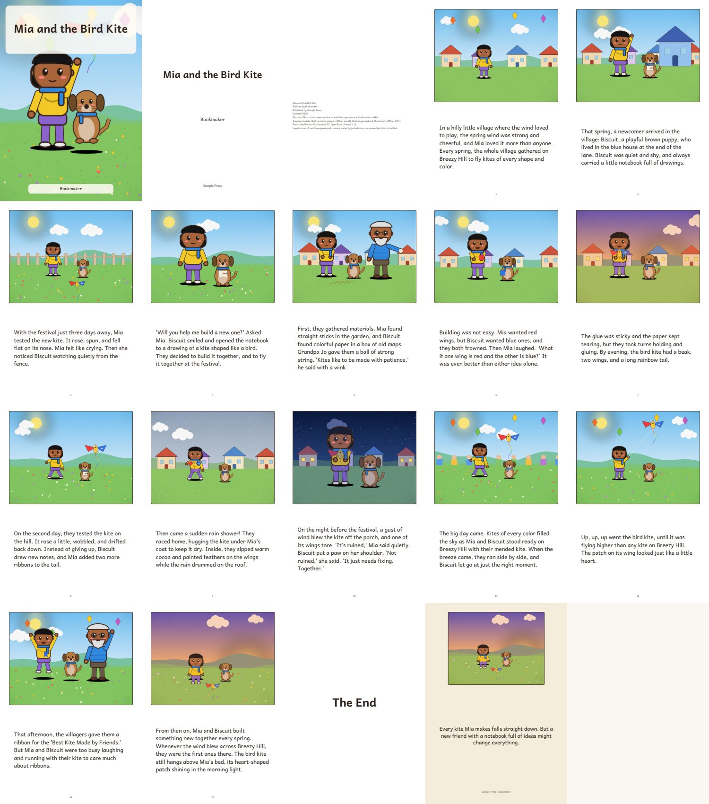
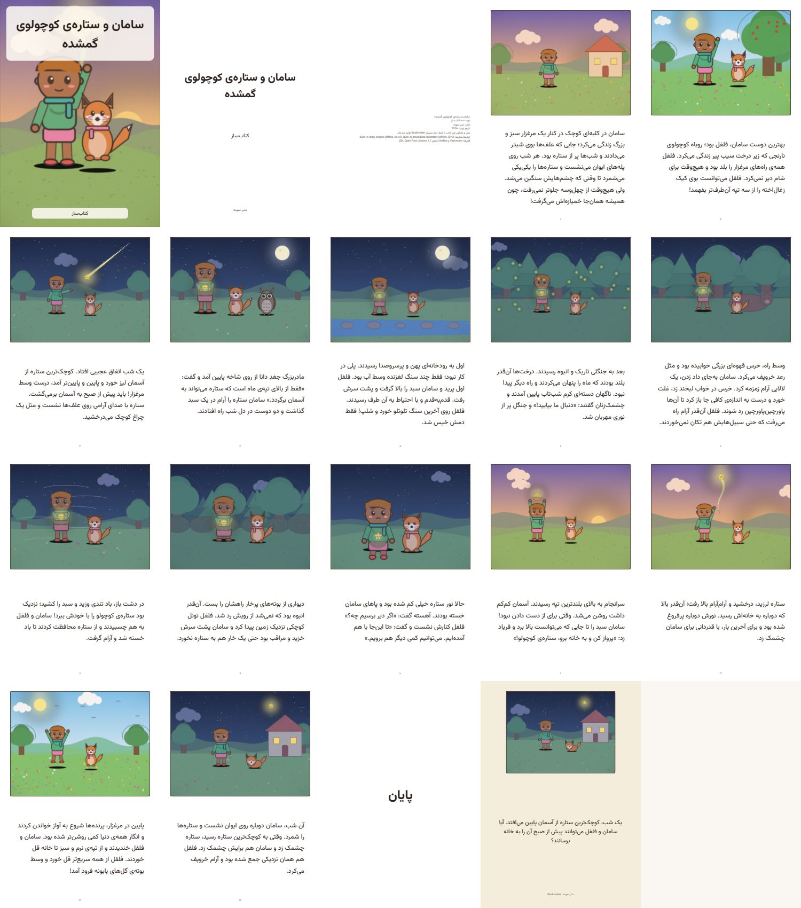
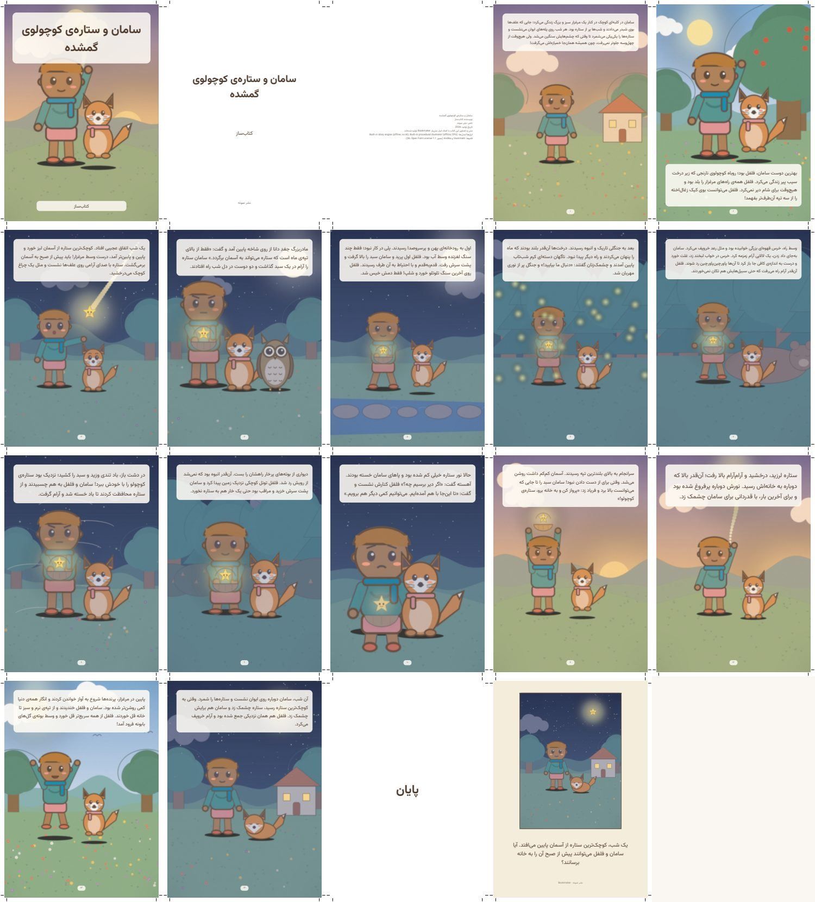
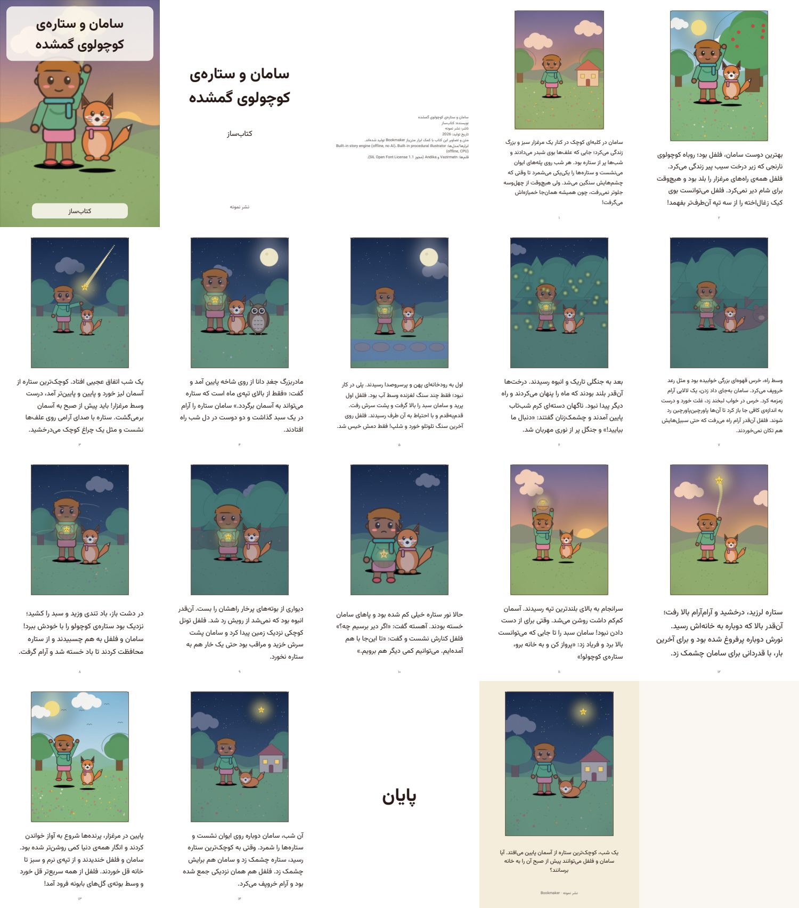
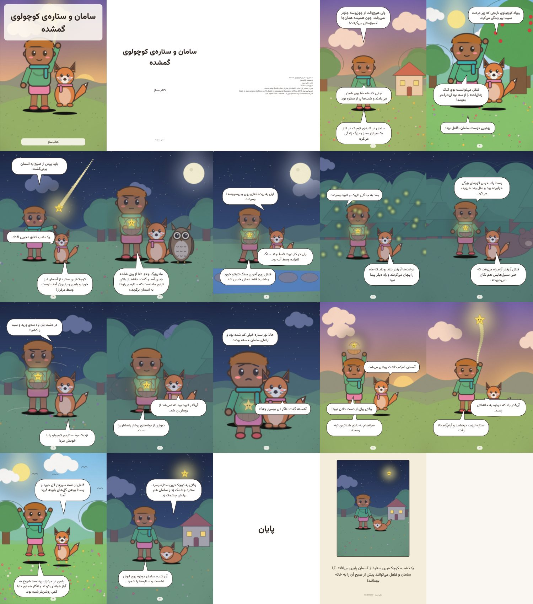

# 📖 Bookmaker: illustrated children's book generator

Bookmaker is a self-hosted web application that turns a topic and a few settings into a **complete illustrated
children's picture book**: a structured story plan → Character Bible → illustrations → professional layout → a validated PDF.
Every stage is checked by independent QA, failures are repaired locally (only the broken part is redone), and the
result is reported honestly.

* **Runs with zero external services.** The built-in story engine and procedural illustrator need no GPU, no internet
  and no API key, so a full book can always be produced.
* **Provider-agnostic AI layer.** Plug in Ollama, any OpenAI-compatible API (OpenAI, OpenRouter, Groq, LM Studio, vLLM,
  llama.cpp server …), Anthropic, ComfyUI or AUTOMATIC1111/Forge, each with retries, fallbacks, rate limits and cost tracking.
* **English and Persian (فارسی)**, with correct right-to-left layout, Arabic-script shaping and mixed Persian/English text.

| Sample (generated by this repo, offline engines) | PDF | Pages |
|---|---|---|
| *Mia and the Silent Stream* (English, 14 story pages) | [`samples/sample-en-silent-stream.pdf`](samples/sample-en-silent-stream.pdf) |  |
| *سامان و ستاره‌ی کوچولوی گمشده* (Persian, 14 story pages; [EPUB with narration](samples/sample-fa-lost-star.epub) validated by EPUBCheck, [read-along video](samples/sample-fa-lost-star.webm) WebM/VP9+Opus, 4:39) | [`samples/sample-fa-lost-star.pdf`](samples/sample-fa-lost-star.pdf) |  |
| Same story, print edition: full-bleed, 3 mm bleed, crop marks, CMYK | [`samples/sample-fa-print-fullbleed-cmyk.pdf`](samples/sample-fa-print-fullbleed-cmyk.pdf) |  |
| Same story as **PDF/X-4** (ICC-based CMYK, output intent, TrimBox): self-check `ok`, 0 issues | [`samples/sample-fa-print-pdfx4.pdf`](samples/sample-fa-print-pdfx4.pdf) |  |
| Same story with **speech bubbles** composed over the illustrations | [`samples/sample-fa-speech-bubbles.pdf`](samples/sample-fa-speech-bubbles.pdf) |  |

Every sample is generated by `scripts/make_samples.py` (the real HTTP API, real worker, built-in engines) and each one
carries a `-report.json` with the full QA report the app produced for it.

> The sample illustrations come from the **procedural vector illustrator** (no AI). Connect an image model
> (ComfyUI/SDXL/FLUX, gpt-image-1, …) to get painterly AI illustrations through the same pipeline.

---

## Quick start

Requirements: Python 3.11+, Node 20+ (only to build the UI), ~1 GB disk. No GPU needed.

```bash
git clone <this repo> bookmaker && cd bookmaker
./run.sh                      # creates .venv, installs deps, builds the UI, serves http://0.0.0.0:8000
```

Manual steps (equivalent):

```bash
python3 -m venv .venv
.venv/bin/pip install -r backend/requirements.txt
.venv/bin/pip install -r backend/requirements-optional.txt   # optional OCR check (~100 MB, CPU)
.venv/bin/pip install -r backend/requirements-media.txt      # optional: EPUBCheck + Java runtime, offline narration (eSpeak NG = GPL-3.0)
.venv/bin/pip install -r backend/requirements-deploy.txt     # optional: PostgreSQL (pg8000) + Redis + OIDC (PyJWT)
# rapidocr installs the GUI OpenCV build, which needs libGL; keep the headless one (run.sh does this):
.venv/bin/pip uninstall -y opencv-python; .venv/bin/pip install --force-reinstall --no-deps opencv-python-headless==5.0.0.93
(cd frontend && npm ci && npm run build)
cd backend && ../.venv/bin/uvicorn app.main:app --host 0.0.0.0 --port 8000
```

Open `http://localhost:8000` → **New book** → choose a preset or fill in the form → **Generate book**.
A 14-page book takes about 30–40 s on 2 CPU cores with the built-in engines.

Headless (no UI):

```bash
cd backend && ../.venv/bin/python cli.py --topic "a brave girl and a lost star" --language fa --pages 12 --out book.pdf
```

Development mode (hot reload): `cd backend && ../.venv/bin/uvicorn app.main:app --reload --port 8000` and
`cd frontend && npm run dev` (Vite on :5173 proxies `/api` to :8000).

Docker: a `Dockerfile` is included (**not built/tested in the development environment**).

## Configuration

Copy `.env.example` to `.env`. Everything is optional:

| Variable | Default | Meaning |
|---|---|---|
| `BOOKMAKER_ENV` | `development` | `production` hides error details and `/api/docs` |
| `BOOKMAKER_DATA_DIR` | `./data` | SQLite DB, project files, trash, backups, encryption key |
| `BOOKMAKER_AUTH_MODE` | auto | `none` (single user, local), `token` (shared `BOOKMAKER_API_TOKEN`), `accounts` (user accounts with login; the first visitor creates the admin). Default: `token` if a token is set, else `none` |
| `BOOKMAKER_API_TOKEN` | – | if set, every `/api` call needs `Authorization: Bearer <token>` (enter it in *Models & providers*) |
| `BOOKMAKER_SESSION_DAYS` | 14 | login session lifetime in `accounts` mode |
| `BOOKMAKER_SECRET_KEY` | auto | Fernet key encrypting stored API keys (auto-generated to `data/.secret.key`, mode 600) |
| `BOOKMAKER_MAX_CONCURRENT_BOOKS` | 1 | books generated in parallel |
| `BOOKMAKER_MAX_CONCURRENT_IMAGES` | 2 | parallel offline renders per book (external APIs run sequentially) |
| `BOOKMAKER_MAX_DISK_GB` | 20 | new books are refused above this project-storage size |
| `BOOKMAKER_MAX_UPLOAD_MB` | 10 | max reference-image upload |
| `BOOKMAKER_RATE_LIMIT_PER_MINUTE` | 240 | per-IP API rate limit (0 = off) |
| `BOOKMAKER_ENABLE_OCR` | true | stray-text detection in illustrations (needs optional deps) |
| `BOOKMAKER_DATABASE_URL` | – | empty = SQLite file in the data dir. Set to `postgresql://user:pw@host:5432/db` to run several workers/containers (driver: pg8000, pure Python) |
| `BOOKMAKER_DB_POOL_SIZE` | 5 | PostgreSQL connection pool size |
| `BOOKMAKER_REDIS_URL` | – | optional: shared worker locks across machines (without it the locks are in-process) |
| `BOOKMAKER_SMTP_*` / `BOOKMAKER_PUBLIC_URL` | – | password-reset e-mail; with no SMTP server the reset link is handed to an admin instead |
| `BOOKMAKER_OIDC_*` | – | single sign-on (any OIDC provider: Keycloak, Authentik, Zitadel, Okta, Entra ID, Google …) |
| `BOOKMAKER_START_WORKER` | auto | set `0` to run the app with no job worker (e.g. a second replica behind a queue) |

Provider API keys are entered in the UI, stored **encrypted**, shown masked (`sk-…abcd`) and redacted from logs.
Instead of a key you can type `env:OPENAI_API_KEY` to read it from the server environment.

## Using the app

* **Dashboard**: running/failed/finished books, queue, API cost, disk and CPU load.
* **New book**: topic, title (or auto-suggest), moral, age group (3-5 / 6-8 / 9-12), language, page count, complexity,
  narration, illustration style, aspect ratio, page size and orientation, number of main characters, hero name, text per page,
  fantasy and humour levels, ending type, cover style, author, publisher, page numbers, back cover, output profile
  (screen 150 dpi / print 300 dpi), seed, providers, image attempts and budget. A live **estimate** shows LLM calls,
  images, time and cost *before* starting; paid runs need explicit confirmation.
* **Story outline review** (optional): the pipeline stops after the text is written (`awaiting_review`); edit pages, then approve
  to start illustrating, so no image money is spent on a story you don't like.
* **Book workspace**
  * *Pages*: view each page's text and illustration, edit text and illustration brief, **regenerate one image**,
    **rewrite one page's text** (optionally with an instruction), approve/lock an image, move pages up or down, add or delete pages,
    see per-image QA issues and every generation attempt (seed, prompt, issues).
    **Repair a region**: paint a mask over a flaw; only the masked pixels change (classical OpenCV inpainting on CPU, or an
    AI inpainting provider: IOPaint/LaMa, ComfyUI, A1111/Forge, stable-diffusion.cpp, OpenAI-compatible `/images/edits`).
    **Revisions (undo)**: every regenerate/rewrite/repair keeps the previous text+image; restore any revision.
    **Narration**: per-page MP3 player when narration is enabled.
  * *Characters*: the Character Bible with reference sheets; edit name, description and signature colours (affected
    pages are redrawn on rebuild); upload your own reference image (validated and re-encoded). A **cast line-up** shows all
    characters at their relative sizes; a size slider fixes scale (a cat stays smaller than a child on every page).
  * *Preview*: book-like viewer built from the real PDF's rendered pages: single or two-page spreads, zoom,
    go-to-page, keyboard arrows (RTL-aware), per-page quality warnings, per-page narration and **read-along** (plays page after page).
  * *Quality report*: story / images / layout / PDF checks with severity and page.
  * *History* (every edit and automated fix with before/after) and *Logs* (every pipeline step).
  * *Export*: **EPUB 3** (validated with EPUBCheck when installed; narration embedded), single-file **HTML reader**
    (page turn, read-aloud), **images + text ZIP**.
  * *Settings*: page size, orientation, cover style, author/publisher, output quality, layout (classic / full-bleed with
    text panel), **print options** (bleed 3–5 mm, crop marks, CMYK) → **Rebuild PDF**.
  * Pause / resume, download PDF, download a full **backup zip**.
* **Library**: search, filter, archive/restore, delete (moved to `data/trash/`, needs typed confirmation).
* **Users** (`accounts` mode): admin creates/disables users; every user sees only their own books; password change;
  login throttling (5 failures → 15 min lock).
* **Models & providers**: add providers, test connection, set defaults (story / image / vision reviewer / narration / inpainting), fallbacks,
  rate limits, pricing, see recent usage and costs.

## Deployment with PostgreSQL and Redis

The default single-container setup needs nothing but a data directory. To scale out (several workers, or several app
replicas sharing one queue):

```bash
cp .env.example .env                 # set POSTGRES_PASSWORD, BOOKMAKER_SECRET_KEY, BOOKMAKER_PUBLIC_URL …
docker compose up -d --build         # postgres + redis + app
docker compose up -d --scale worker=2   # two workers on the same queue
```

Workers claim jobs with `SELECT … FOR UPDATE SKIP LOCKED`, so a job is never handed to two processes. Redis is optional:
without it the worker locks are per-process, which is correct for a single instance. Both code paths are covered by
`backend/tests/test_postgres_redis.py` against a real PostgreSQL 16 server started locally by `pgserver`.

## Documentation

| Document | Content |
|---|---|
| [docs/ARCHITECTURE.md](docs/ARCHITECTURE.md) | components, pipeline stages, data model, QA & repair loop, resource management, security |
| [docs/PROVIDERS.md](docs/PROVIDERS.md) | connecting local models (Ollama, LM Studio, ComfyUI, A1111) and APIs; character consistency setups |
| [docs/RESEARCH.md](docs/RESEARCH.md) | survey of open-source projects/models, maintenance, licences, why this architecture |
| [docs/TROUBLESHOOTING.md](docs/TROUBLESHOOTING.md) | common problems and fixes |
| [docs/TEST_REPORT.md](docs/TEST_REPORT.md) | test results, feature status (tested / partial / missing), known limitations |
| [THIRD_PARTY_LICENSES.md](THIRD_PARTY_LICENSES.md) | libraries, fonts and their licences |

Run the tests: `cd backend && ../.venv/bin/python -m pytest -q` (235 tests) and `cd frontend && npm test` (18 tests).
Browser end-to-end test (real Chromium): see the header of `frontend/e2e/browser-e2e.mjs`.

---

## راهنمای سریع فارسی

**کتاب‌ساز** یک وب‌اپلیکیشن متن‌باز برای تولید کتاب داستان مصور کودک است: طرح داستان ← پرونده‌ی شخصیت‌ها ← تصویرسازی ← صفحه‌آرایی ← PDF معتبر.
هر مرحله با کنترل کیفیت مستقل بررسی می‌شود و اگر خطایی پیدا شود، فقط همان بخش دوباره ساخته می‌شود.

* اجرا: `./run.sh` و سپس باز کردن `http://localhost:8000`. با دکمه‌ی «فارسی» در بالای صفحه، رابط کاربری راست‌چین می‌شود.
* بدون اینترنت، GPU یا کلید API هم کار می‌کند (موتور داستان داخلی + تصویرساز رویه‌ای). برای تولید با هوش مصنوعی، در بخش «مدل‌ها و سرویس‌ها» Ollama، یک API سازگار با OpenAI، ComfyUI یا Automatic1111 را اضافه کنید.
* متن فارسی با قلم Vazirmatn، اتصال صحیح حروف، نیم‌فاصله و ترتیب درست خطوط و متن ترکیبی فارسی/انگلیسی در PDF قرار می‌گیرد.
* موتور داستان داخلی مبتنی بر قالب‌های دست‌نویس است (هوش مصنوعی نیست)، ۶ تا ۱۸ صفحه و زبان‌های فارسی و انگلیسی را پشتیبانی می‌کند. برای موضوع آزاد و صفحات بیشتر (تا ۴۰) یک مدل زبانی متصل کنید.
* جزئیات وضعیت قابلیت‌ها و محدودیت‌ها در [docs/TEST_REPORT.md](docs/TEST_REPORT.md) آمده است.
